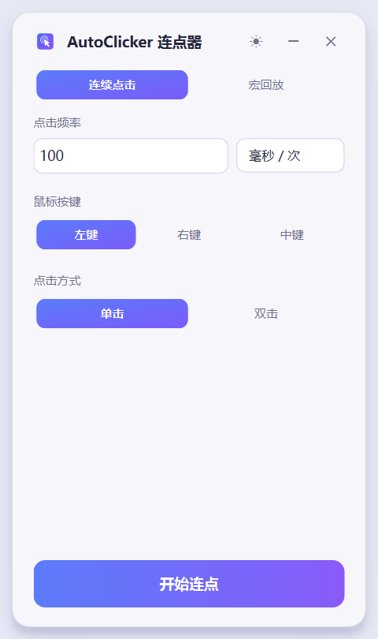
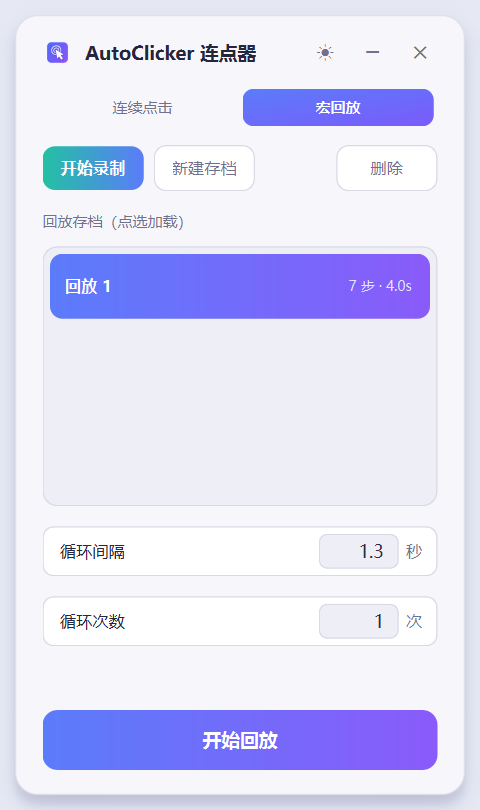

<p align="center">
  
</p>

<h1 align="center">AutoClicker 连点器</h1>

<p align="center">
  一款开箱即用的桌面连点器：连续点击 + 宏录制回放，免安装、无广告、开源。<br>
  作者 · <b>cui-huajin / yueryuyueryun</b>
</p>

<p align="center">
  
  
  
  
</p>

<p align="center">
  
  &nbsp;&nbsp;
  
</p>

## 功能特性

- **连续点击** — 设定频率（毫秒/次）、鼠标按键（左/右/中）、单双击后自动连点，执行中可实时改次数。
- **宏录制回放** — 录下真实点击的位置、按键与间隔，之后原样回放；支持循环次数与两轮之间的循环间隔。
- **多存档管理** — 宏回放页的存档列表可视化展示全部存档（步数/时长），点选即加载；支持新建、覆盖、删除。
- **紧凑悬浮条** — 开始录制或执行后，窗口收缩为屏幕顶部的悬浮控制条并**永久置顶**，全屏游戏或新开窗都遮不住它；停止后展开还原。
- **灵动界面** — 无边框圆角卡片、浅色/深色双主题、水滴流转的分段切换与页转动画，全程无闪烁无残影。
- **免安装** — Windows 版为绿色文件夹，拷到任意 Windows 电脑双击即用，不需要 Python 环境。

## 三个可用版本

| 版本 | 目录 | 形态 | 适用场景 |
| ---- | ---- | ---- | -------- |
| **Windows 图形版** | [`windows/`](windows/) | PySide6 桌面应用，打包为免安装 exe | 日常使用，功能最全 |
| **命令行脚本版** | [`script/`](script/README.md) | 纯 Python 单文件，无 GUI | 服务器/远程桌面/自动化脚本串联 |
| **Android 版** | [`android/`](android/README.md) | Kotlin 无障碍服务 App 工程 | 手机端连点与宏回放，无需 root |

三个版本共用同一套宏存档 JSON 结构（`steps` / `gap` / `loops`），录制的存档可跨版本互换回放。

### Windows 图形版

全部源码与打包配置在 [`windows/`](windows/) 目录。仓库已附打包成品 [`AutoClicker-Windows-v1.1.0.zip`](windows/AutoClicker-Windows-v1.1.0.zip)：解压后双击 `AutoClicker.exe` 即用；也可从源码自行打包（见下文「从源码打包」）。

### 录制抓不到点击怎么办（v1.1.0 起）

v1.1.0 重写了 Windows 的录制采集层：不再是单一的低级鼠标钩子，而是**三路同时采集**——

| 通道 | 手段 | 顶得住的场景 |
| ---- | ---- | ------------ |
| A 钩子 | `SetWindowsHookEx(WH_MOUSE_LL)` | 普通窗口、后台窗口 |
| B 轮询 | `GetAsyncKeyState` + `GetCursorPos` | 钩子被游戏/反作弊摘掉时仍可用 |
| C 原始输入 | `RegisterRawInputDevices(RIDEV_INPUTSINK)` | 钩子拿不到消息、光标被游戏锁定指针时 |

三路事件按 30ms 去重合并，任一路活着就能录到，录制期间**不再显示"无法识别"**。若真的一步都没录到，停止录制时会弹窗告诉你三路各收到了多少事件，并给出下一步动作：

1. 录制时点的是**游戏画面**，不要点悬浮条或面板按钮（落在本程序窗口上的点击会被自动过滤）；
2. 游戏若以**管理员身份**运行，请把 AutoClicker 也用管理员身份重开——否则回放时系统会丢弃注入的点击（UIPI 隔离）。弹窗里有一键「以管理员身份重启」；
3. 全屏独占（exclusive fullscreen）游戏对输入抓取更严格，请先切到**窗口化 / 无边框窗口**再录。

录音时的悬浮条左侧会实时显示「● 已录制 N 步」，一眼就能看出到底有没有记录下来。

坐标自 v1.1.0 起统一按**物理像素**存盘，多显示器不同缩放比例下回放也不会偏。

### 一键自检（排查录制问题最快的办法）

把录制问题反馈给作者之前，先在命令行跑一次自检：

```bat
cd AutoClicker
AutoClicker.exe --selftest
```

它会自动开始录制 → 在自己悬浮条上模拟两次点击（安全，不会点到别的程序）→ 校验三路通道是否都收到了事件 → 把结果写到 exe 同目录的 `selftest.log`，然后自动退出。日志长这样：

```
通道 钩子=True 原始输入=True 轮询线程=True 错误=无
事件统计 钩子 4 / 轮询 4 / 原始输入 4
结论 通过：录制通道工作正常（事件 12，步骤 0）；桌面被窗口铺满，桌面点击校验已跳过
```

「钩子 / 轮询 / 原始输入」三列有一个非 0，就说明这台机器能录到点击；三列全 0 才说明系统层面把鼠标事件挡住了（通常是权限或安全软件），此时用管理员身份重开再跑一次自检。

### 命令行脚本版

```bash
pip install pynput

python script/autoclicker_cli.py click --interval 100 --count 50     # 光标处连点 50 次
python script/autoclicker_cli.py record --out macro.json             # 录制，Ctrl+C 存盘
python script/autoclicker_cli.py replay macro.json --loops 10        # 回放 10 轮
```

详见 [`script/README.md`](script/README.md)。

### Android 版

基于无障碍服务（`AccessibilityService.dispatchGesture`）注入点击手势，**无需 root**。
用 Android Studio 打开 `android/` 目录编译安装后：开启无障碍服务 → 授予悬浮窗权限 → 悬浮控制条即可连点或回放宏。

详见 [`android/README.md`](android/README.md)。

## 宏存档格式

```json
{
  "name": "回放 1",
  "steps": [
    { "x": 960, "y": 540, "button": "左", "count": 1, "interval": 120 }
  ],
  "gap": 500,
  "loops": 3,
  "v": 2
}
```

- `x` / `y`：**物理像素**屏幕坐标（v2 起；v1 存档是 Qt 逻辑像素，首次加载会自动乘缩放比并补 `v: 2`）；
- `button`：`左` / `右` / `中`（无法识别时按左键处理）；
- `count`：该步连点次数；
- `interval`：该步点击完成后到下一步的等待毫秒数；
- `gap`：两轮回放之间的循环间隔毫秒数；
- `loops`：默认回放轮数，0 为无限。

> 注意：v2 存档里的坐标是物理像素，用 **v1.0.0 及更早的旧版** 打开会被再乘一次缩放比（1080p@125% 下回放偏到 1.25 倍位置）。换新版打开即可，无需手工改文件。

## 从源码打包（Windows 版）

需 conda 环境（PySide6、pynput、pyinstaller）：

```bash
conda create -n autoclicker python=3.10
conda activate autoclicker
pip install pyside6 pynput pyinstaller

cd windows
python -m PyInstaller --distpath dist AutoClicker.spec
```

产物输出到 `windows/dist/AutoClicker/`，整个文件夹即交付物，请勿拆散目录结构。

## 目录结构

```
.
├─ windows/                                   Windows 图形版（源码 / 图标 / 打包配置 / 截图）
├─ script/                                    命令行脚本版（纯 Python）
├─ android/                                   Android 无障碍服务 App 工程（Kotlin）
├─ LICENSE                                    MIT 开源协议
└─ README.md                                  本文件
```

## 开源协议

本项目以 [MIT License](LICENSE) 开源，可自由使用、修改与分发，惟需保留版权声明。

---

<p align="center">
  <b>AutoClicker</b> · Made by cui-huajin / yueryuyueryun · 2026
</p>
